# Mamba vs. Transformer, from scratch

**A selective state-space model (Mamba/S6), a GPT-style Transformer, RetNet-style linear attention and a hybrid, all
written from first principles in PyTorch, plus a hand-written Triton kernel for the selective scan. Benchmarked for
speed, memory and quality on one 4 GB laptop GPU.**

No `nn.MultiheadAttention`, no FlashAttention, no `mamba_ssm`. Every mechanism (attention with RoPE and a KV cache, ZOH
discretization, the selective recurrence, four parallel-scan algorithms, the scan's backward pass, a fused GPU kernel)
is implemented here and checked against an independent reference in the test suite.

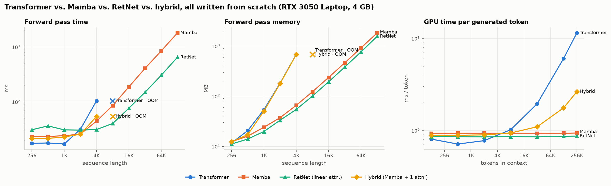

**Interactive results:** [`docs/index.html`](docs/index.html) has hoverable versions of every chart and a live view of
what the selection mechanism writes into the state. Open it in a browser, or host it with GitHub Pages
(Settings → Pages → deploy from `main`, folder `/docs`).

---

## Contents

1. [Key findings](#1-key-findings)
2. [Background: why these architectures](#2-background)
3. [What is implemented](#3-implementation)
4. [How correctness is verified](#4-verification)
5. [Experiments](#5-experiments)
6. [Engineering notes](#6-engineering-notes-problems-hit-on-real-hardware)
7. [Limitations](#7-limitations)
8. [Reproduce](#8-reproduce)
9. [Repository layout](#9-repository-layout)
10. [References](#10-references)

---

## 1. Key findings

All numbers come from one RTX 3050 Laptop GPU (4 GB). Every model has about 4.7M non-embedding parameters and was
trained on the same 32.8M bytes of enwik8.

| | Transformer | Mamba | RetNet | **Hybrid** |
|---|---|---|---|---|
| enwik8 test bpc @ 512 (training length) | 1.651 | 1.673 | 1.802 | **1.608** |
| test bpc @ 4K context (8× training length) | 3.905 | 1.631 | 1.765 | **1.554** |
| longest sequence for one forward pass (4 GB; 128K was the largest tested) | 4K | **≥128K** | **≥128K** | 4K |
| GPU time per generated token @ 256K context | 11.46 ms | 0.94 ms | **0.87 ms** | 2.64 ms |
| cache / state size @ 256K context | 1536 MB | **0.38 MB** | **0.38 MB** | 256 MB |
| training throughput (batch 16 × 512) | 64.9k tok/s | 42.8k tok/s | **71.2k tok/s** | 46.0k tok/s |

1. **Quality is a draw at the training length, and the hybrid wins.** At 512 bytes the Transformer (1.651 bpc) and
   Mamba (1.673) are within the noise one would expect from a single seed. The Jamba-style hybrid (9 Mamba layers + 1
   attention layer) is clearly best at **1.608**. Mamba learned fastest early on: 1.998 vs. 2.258 bpc after 1,000 steps.
2. **The recurrent models generalize to longer contexts; the Transformer collapses.** Evaluated beyond its 512-byte
   training length, the RoPE Transformer degrades from 1.62 to 3.91 bpc at 4K. Mamba keeps *improving* with more
   context (1.657 → 1.629 at 8K) because its recurrent state has no notion of a maximum length. The hybrid inherits this:
   it improves to 1.541 at 2K and is still at 1.554 at 4K, despite containing an attention layer.
3. **The quadratic wall is real, and it arrives early.** Hand-written attention runs out of the 4 GB at 8K tokens
   (forward) and 4K (training). Mamba runs a forward pass at **128K** tokens. Mamba is faster than this Transformer from
   2K tokens on, and even PyTorch's fused attention kernel is 3.2× slower than Mamba at 128K.
4. **Generation cost stays constant.** Per generated token, Mamba's GPU time is flat at 0.93 ms (RetNet: 0.85 ms) from
   128 to 256K tokens of context, and its state is 0.38 MB. The Transformer's cost grows 14× over the same range, to
   11.5 ms, with a 1.5 GB KV cache. The hybrid sits in between: one attention layer means 1/6 of the cache.
5. **The fused kernel is what makes Mamba practical.** In the forward pass, the Triton scan is 8× faster than the
   best pure-PyTorch scan at 4K tokens and 18.6× faster at 64K, and uses 41× less memory. Training the full Mamba model
   went from 3.8k to 42.8k tokens/s (11×).
6. **Selection matters, and discretization doesn't.** Freezing Δ, B, C (an LTI SSM) costs +0.047 bpc at equal steps.
   Exact ZOH, Euler and bilinear discretization are indistinguishable (1.998 / 1.998 / 1.995).
7. **What selection learned.** Δ spikes at word starts (1.76× the layer mean) and newlines (up to 2.6×), and drops
   inside words (0.75×). The model writes new information at boundaries and carries the state through predictable bytes.
8. **Exact recall is attention's strength.** On associative recall and selective copying, models with at least one
   attention layer learn within 3,000 steps; pure Mamba does not yet. The hybrid is best: 99.0% recall with 4 pairs
   and 100.0% selective copying, against 7.8% and 12.8% for pure Mamba. This matches the Zoology / Jamba findings.

---

## 2. Background

**Attention.** A causal Transformer layer computes `softmax(QKᵀ/√d + mask) V`. The score matrix has `T × T` entries, so
a forward pass costs O(T²) time and (without fused kernels) O(T²) memory. At generation time the model caches every
past key and value: the KV cache grows linearly with the context, and each new token attends over all of it (O(T) per
token).

**State-space models.** An SSM maps an input sequence `x(t)` to an output through a latent state `h(t)`:

```
dh/dt = A h(t) + B x(t)          y(t) = C h(t) + D x(t)
```

Discretizing with step size Δ gives a linear recurrence `h_t = Ā h_{t-1} + B̄ x_t`. Processing a sequence costs O(T)
and generation keeps only `h`, a fixed-size state, no matter how long the context is.

**Selection (Mamba / S6).** Earlier SSMs (S4) use the same Δ, B, C at every step: a linear time-invariant (LTI)
system, equivalent to one long convolution. It cannot decide to ignore a token based on its content. Mamba makes
**Δ, B and C functions of the current input**: a large Δ_t overwrites the state with the current token, and a small Δ_t
keeps the state and skips the token. The price is that the convolution trick no longer works. The model needs a
*scan*, which this project implements four ways plus a fused kernel.

**The open question this project measures:** does the efficient architecture cost accuracy? Where is the speed
crossover on real hardware? And what can a fixed-size state *not* do?

---

## 3. Implementation

### 3.1 Transformer, [`models/transformer.py`](models/transformer.py)
- Hand-written multi-head causal attention: QKV projection, scaled dot-product, explicit causal mask, softmax in fp32.
- Rotary position embeddings (RoPE), written out.
- **Explicit KV cache**: preallocated `(B, H, T_max, d_head)` buffers. Prefill, chunked prefill and token-by-token
  decoding all produce exactly the same logits as a full forward pass (tested).
- An optional `attn_impl="sdpa"` uses PyTorch's fused kernel. It serves only as a reference line in the benchmarks.

### 3.2 Mamba block, [`models/mamba.py`](models/mamba.py)

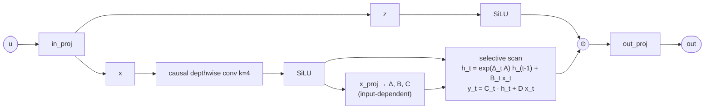

- A is diagonal, negative and learned (`A = -exp(A_log)`), with the S4D-real initialization `A_n = -(n+1)`. Δ uses
  Mamba's inverse-softplus initialization in `[1e-3, 0.1]`.
- **Three discretizations** ([`models/scan.py`](models/scan.py)): exact zero-order hold
  `Ā = exp(ΔA), B̄ = (exp(ΔA) − 1)/A · B` (the default), Mamba's simplified Euler `B̄ = ΔB`, and bilinear/Tustin.
- **`selective=False`** turns Δ, B, C into learned constants. This is the LTI (S4D-style) ablation from the Mamba paper.
- Recurrent inference: the state is the last 3 conv inputs plus the `(d_inner × d_state)` SSM state per layer, and
  its size is independent of context length.

### 3.3 Scan algorithms and a hand-written backward pass, [`models/scan.py`](models/scan.py)

The recurrence `h_t = a_t h_{t-1} + b_t` is associative under `(a₂, b₂) ∘ (a₁, b₁) = (a₂a₁, a₂b₁ + b₂)`, so it can be
computed in parallel:

| algorithm | work | depth (sequential steps) | idea |
|---|---|---|---|
| `sequential` | O(L) | O(L) | the textbook loop |
| `hillis_steele` | O(L log L) | O(log L) | recursive doubling |
| `blelloch` | O(L) | O(2 log L) | up-sweep reduction tree, down-sweep of exclusive prefixes |
| `chunked` | O(L) | O(√L + log L) | sequential inside chunks, log-depth scan across chunk boundaries |
| `triton` | O(L) | O(L) per tile, all tiles in parallel | fused kernel, state kept in registers (§3.4) |

**Backward pass without storing states.** `SelectiveScanFn` is a custom `autograd.Function`. It saves only the
`(B, L, D)` / `(B, L, N)` inputs, not the `(B, L, D, N)` states. In backward it recomputes the states and runs the
**adjoint recurrence**, which is itself a reverse scan:

```
dh_t = C_t · dy_t + a_{t+1} · dh_{t+1}          (reverse scan, same algorithms as forward)
da_t = dh_t · h_{t-1}        db_t = dh_t        → dΔ, dA, dB, dx through the discretization
dC_t = Σ_d dy_t[d] · h_t[d, :]
```

Channels are processed in tiles sized to a fixed memory budget, so peak memory stays bounded at any sequence length.

### 3.4 Fused Triton kernel, [`kernels/triton_scan.py`](kernels/triton_scan.py)

The PyTorch scans are memory-bandwidth bound because they write `a`, `b`, `h` of shape `(B, L, D, N)` to DRAM. That is
16× more data than the inputs when `d_state = 16`. Mamba's key systems idea is to keep the state on chip. Each Triton
program owns a `(BLOCK_D × N)` tile of the state in registers and walks the sequence: it reads `x, Δ` (B, L, D) and
`B, C` (B, L, N), and writes only `y`. The backward kernel walks the sequence in reverse with the adjoint recurrence.
It applies the exact ZOH derivatives, including a series expansion of `d/dA [expm1(ΔA)/A]` for small `ΔA`, where the
closed form cancels catastrophically in fp32.

### 3.5 Retention (RetNet-style linear attention), [`models/retention.py`](models/retention.py)

`o_t = Σ_{s≤t} γ^(t−s) (q_t·k_s) v_s`, one decay γ per head. Three equivalent forms are implemented and tested equal:
parallel O(T²), recurrent with an O(1) `d_head × d_head` state, and chunkwise (used for training) at O(T·C). It is a
useful midpoint between the other two: query-key matching like attention, and a fixed-size state with a *fixed*, not
selective, decay like an LTI SSM.

### 3.6 Language model and hybrid, [`models/lm.py`](models/lm.py)

One `LM` class takes a layer pattern: `A` = attention + MLP, `M` = Mamba, `R` = retention + MLP. All four experiment
models use d_model = 256 and are **parameter-matched to within about 2%**:

| model | layers | non-embedding params | training throughput (tokens/s) | training memory |
|---|---|---|---|---|
| Transformer | `AAAAAA` | 4.72M | 64.9k | 1.22 GB |
| Mamba | `MMMMMMMMMMM` | 4.82M | 42.8k | 1.81 GB |
| RetNet | `RRRRRR` | 4.72M | 71.2k | 0.91 GB |
| Hybrid | `MMMMMAMMMM` | 4.73M | 46.0k | 1.71 GB |

---

## 4. Verification

`pytest` runs 136 tests (CI runs the CPU ones on every push):

| what is checked | how |
|---|---|
| every scan algorithm | equals the sequential loop for L ∈ {1, 2, 7, 16, 37, 64, 100}, with and without an initial state |
| the sequential loop | equals an explicit NumPy triple loop (brute force) |
| custom backward (4 scans × 3 discretizations × h0) | gradients of all 6 inputs equal autograd through the reference loop (fp64) |
| `gradcheck` | finite-difference check of the selective scan |
| diagonal ZOH | equals dense `matrix_exp` ZOH; dense ZOH equals an RK4 integration of the ODE (exact for piecewise-constant input) |
| Euler / bilinear | converge to ZOH as Δ → 0 |
| Triton kernels | forward + all six gradients equal the PyTorch path (ZOH, Euler, bilinear; with/without h0; ragged shapes); the block-parallel forward variant too |
| causality | changing future tokens never changes past logits (all architectures) |
| KV cache / recurrent state | prefill + chunked prefill + step-by-step decoding equals the full forward pass (all architectures) |
| retention | chunkwise == parallel == recurrent |
| fused vs. manual attention | identical outputs |
| state size | KV cache grows linearly with max length; Mamba / retention state is constant |
| learning | each architecture overfits a small batch |

---

## 5. Experiments

### 5.1 Selective-scan algorithms

One Mamba layer (1 sequence, 512 channels, 16 state dimensions), median of repeated CUDA-synchronized runs:

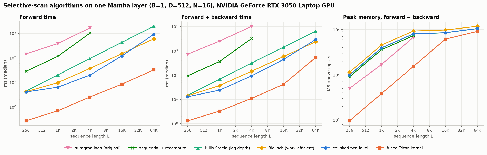

| scan | L=256 fwd / fwd+bwd (ms) | L=1K fwd / fwd+bwd (ms) | L=4K fwd / fwd+bwd (ms) | L=16K fwd / fwd+bwd (ms) | L=64K fwd / fwd+bwd (ms) | peak mem fwd+bwd @ max L |
|---|---|---|---|---|---|---|
| `reference` | 145.1 / 730.9 | 382.8 / 2515.8 | 1659.2 / 10232.2 | - | - | 672 MB @ 4K |
| `sequential` | 28.1 / 93.4 | 115.7 / 365.2 | 1010.6 / 3248.5 | - | - | 729 MB @ 4K |
| `hillis_steele` | 4.4 / 14.8 | 20.2 / 68.4 | 94.0 / 315.9 | 429.6 / 1428.7 | 1937.7 / 6385.0 | 1044 MB @ 64K |
| `blelloch` | 4.1 / 14.1 | 9.8 / 37.3 | 36.8 / 144.7 | 148.3 / 582.5 | 597.2 / 2360.9 | 1172 MB @ 64K |
| `chunked` | 4.0 / 12.9 | 6.4 / 24.2 | 19.7 / 93.0 | 119.7 / 444.2 | 912.2 / 2908.2 | 1045 MB @ 64K |
| `triton` | 0.27 / 1.3 | 0.69 / 3.3 | 2.5 / 11.0 | 8.4 / 42.0 | 32.2 / 526.5 | 904 MB @ 64K |

At 4K tokens the parallel scans are 11–51× faster than the sequential loop (Hillis–Steele 11×, Blelloch 27×, chunked
51×). The work-efficient algorithms beat Hillis–Steele, whose O(L log L) work shows up directly as time on a
bandwidth-bound GPU. All of the PyTorch scans pay to
write `(L × 512 × 16)` float32 states to DRAM. The fused kernel doesn't, which accounts for its 8–18.6× margin over the best of them.

### 5.2 Speed and memory vs. sequence length

Batch 1, bf16 autocast, ~4.7M-parameter models; × marks the length that ran out of memory.

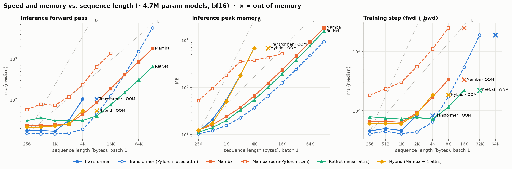

**Inference forward pass, batch 1 (ms)**

| model | 1K | 4K | 16K | 64K | 128K | longest length that fits |
|---|---|---|---|---|---|---|
| Transformer | 17.0 | 104.3 | OOM | OOM | OOM | 4K |
| Transformer (PyTorch fused attn.) | 14.8 | 19.0 | 126.1 | 1519.1 | 5763.1 | 128K |
| Mamba | 24.2 | 44.5 | 187.4 | 848.9 | 1800.3 | 128K |
| Mamba (pure-PyTorch scan) | 73.4 | 235.1 | 1373.0 | OOM | OOM | 16K |
| RetNet | 30.9 | 31.2 | 76.6 | 305.7 | 648.1 | 128K |
| Hybrid | 22.9 | 54.2 | OOM | OOM | OOM | 4K |

**Training step fwd+bwd, batch 1 (ms)**

| model | 1K | 4K | 16K | 64K | 128K | longest length that fits |
|---|---|---|---|---|---|---|
| Transformer | 46.1 | OOM | OOM | OOM | OOM | 2K |
| Transformer (PyTorch fused attn.) | 40.7 | 64.4 | 545.2 | OOM | OOM | 32K |
| Mamba | 63.8 | 170.1 | OOM | OOM | OOM | 8K |
| Mamba (pure-PyTorch scan) | 301.9 | 1104.3 | OOM | OOM | OOM | 8K |
| RetNet | 72.1 | 72.3 | 220.9 | OOM | OOM | 16K |
| Hybrid | 60.0 | 185.5 | OOM | OOM | OOM | 4K |

- crossover (fwd): Mamba faster than Transformer from L = 2K
- crossover (train): Mamba faster than Transformer from L = 4K

### 5.3 Generation: KV cache vs. recurrent state

For a context of P tokens: the cost of one decode step, and the size of what the model has to keep. Eager PyTorch adds
14–25 ms of kernel-launch overhead per token on this machine (hundreds of tiny kernels per step). The numbers below
replay each step from a captured CUDA graph, which isolates the GPU work.

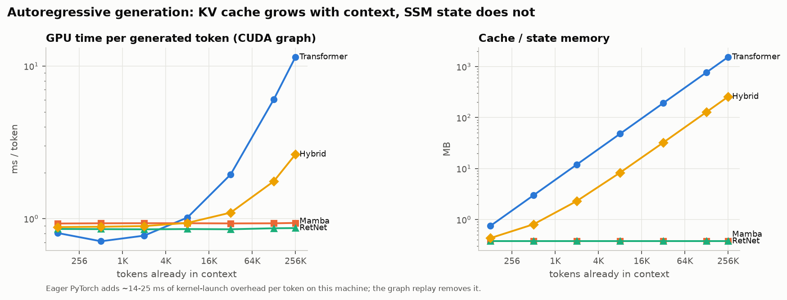

GPU time per generated token (CUDA graph replay) · cache/state size

| model | 128 ctx | 512 ctx | 2K ctx | 8K ctx | 32K ctx | 128K ctx | 256K ctx |
|---|---|---|---|---|---|---|---|
| Transformer | 0.80 ms · 0.75 MB | 0.71 ms · 3 MB | 0.77 ms · 12 MB | 1.02 ms · 48 MB | 1.95 ms · 192 MB | 6.05 ms · 768 MB | 11.46 ms · 1536 MB |
| Mamba | 0.93 ms · 0.376 MB | 0.93 ms · 0.376 MB | 0.93 ms · 0.376 MB | 0.93 ms · 0.376 MB | 0.93 ms · 0.376 MB | 0.93 ms · 0.376 MB | 0.94 ms · 0.376 MB |
| RetNet | 0.86 ms · 0.375 MB | 0.85 ms · 0.375 MB | 0.85 ms · 0.375 MB | 0.85 ms · 0.375 MB | 0.85 ms · 0.375 MB | 0.86 ms · 0.375 MB | 0.87 ms · 0.375 MB |
| Hybrid | 0.88 ms · 0.4326 MB | 0.88 ms · 0.8076 MB | 0.89 ms · 2.308 MB | 0.94 ms · 8.308 MB | 1.09 ms · 32.31 MB | 1.76 ms · 128.3 MB | 2.64 ms · 256.3 MB |

### 5.4 Language modeling quality on enwik8

AdamW (β = 0.9, 0.95; weight decay 0.1), learning rate 1.5e-3 with 200 warmup steps and cosine decay to 1e-4, batch
16 × 512 bytes, 4,000 steps (32.8M bytes), bf16 autocast, gradient clipping at 1.0, seed 0. The test set is the full
5 MB held-out split. Longer-context columns use the first 2 MB of it.

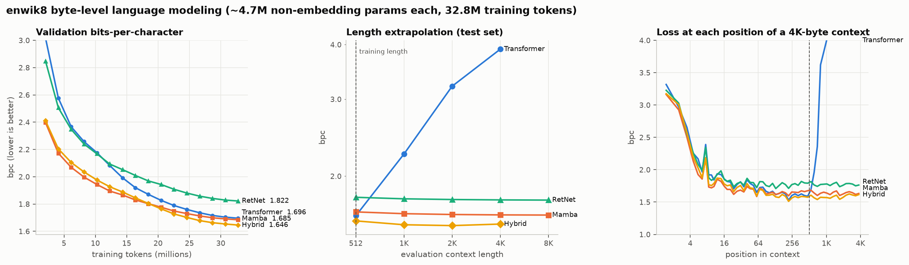

| model | val bpc | **test bpc** (ctx 512) | test @ 1K | test @ 2K | test @ 4K | test @ 8K |
|---|---|---|---|---|---|---|
| Transformer | 1.696 | **1.651** | 2.248 | 3.213 | 3.905 | OOM |
| Mamba | 1.685 | **1.673** | 1.641 | 1.634 | 1.631 | 1.629 |
| RetNet | 1.822 | **1.802** | 1.775 | 1.769 | 1.765 | 1.763 |
| Hybrid | 1.646 | **1.608** | 1.548 | 1.541 | 1.554 | OOM |

The right-hand panel above shows the mechanism behind finding 2. Within one 4K-byte window, the Transformer's loss
jumps from ~1.6 to >4 bpc the moment positions pass 512, the largest offset RoPE saw in training. The recurrent models
just keep using the extra context.

Samples from each model (temperature 0.8, top-k 40) are in [`results/samples.md`](results/samples.md). All four
produce wiki-markup-shaped English at this scale.

### 5.5 Ablations: selection and discretization

Same data, same 4,000-step learning-rate schedule, compared over the first 1,000 steps:

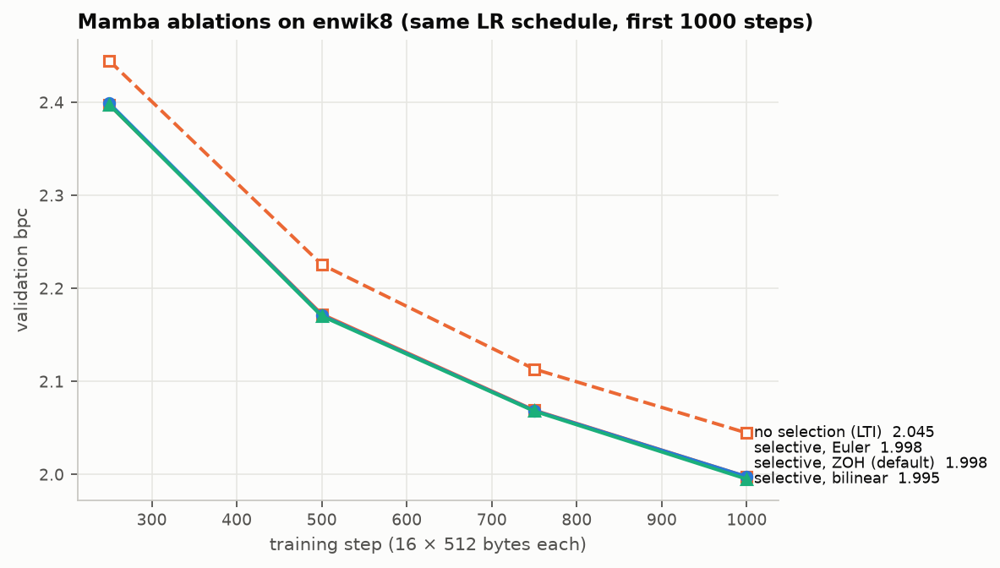

| Mamba variant | val bpc @ step 500 | val bpc @ step 1000 | Δ vs default |
|---|---|---|---|
| selective Δ,B,C · exact ZOH (default) | 2.172 | 1.998 | — |
| **no selection** (LTI: Δ,B,C constant) | 2.226 | 2.045 | +0.047 |
| Euler B̄ = ΔB (Mamba's simplification) | 2.171 | 1.998 | +0.000 |
| bilinear / Tustin | 2.170 | 1.995 | -0.003 |

### 5.6 Synthetic tasks: associative recall and selective copying

Two-layer-sized models (d_model = 64, roughly 100–130K parameters), 3,000 steps each, fresh random data every step.

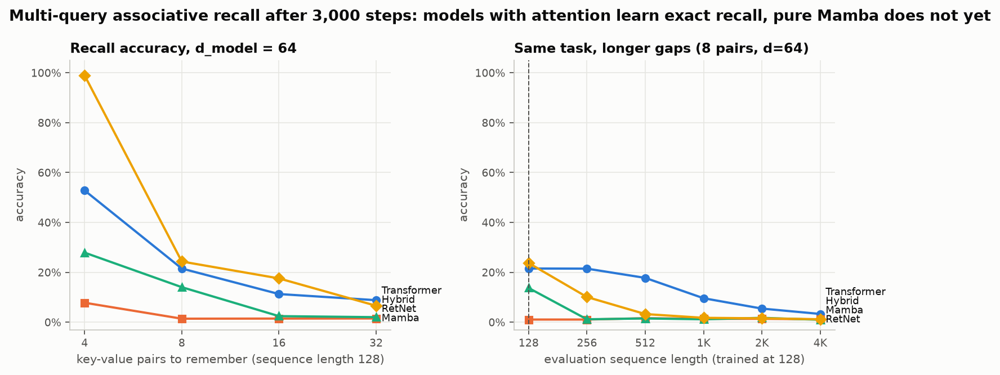
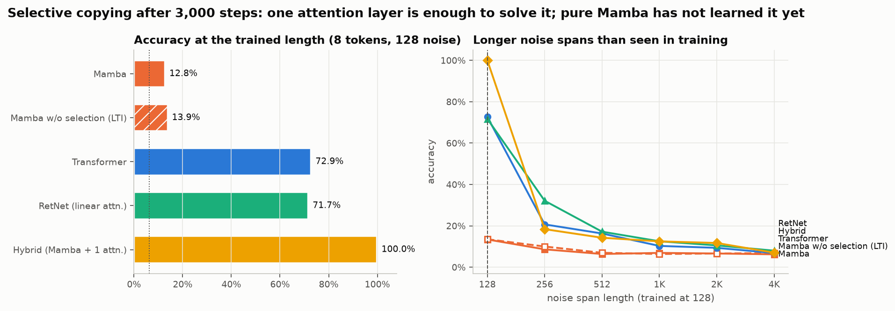

| model (d_model 64) | 4 pairs | 8 pairs | 16 pairs | 32 pairs |
|---|---|---|---|---|
| Transformer | 52.8% | 21.5% | 11.3% | 8.8% |
| Mamba | 7.8% | 1.4% | 1.5% | 1.5% |
| RetNet | 27.9% | 14.1% | 2.4% | 2.0% |
| Hybrid | 99.0% | 24.3% | 17.6% | 6.6% |

| model | params | accuracy (trained length) | @ 256 | @ 512 | @ 1K | @ 2K | @ 4K |
|---|---|---|---|---|---|---|---|
| Mamba | 131K | **12.8%** | 8.6% | 6.4% | 6.9% | 6.6% | 6.2% |
| Mamba w/o selection (LTI) | 111K | **13.9%** | 10.0% | 7.0% | 6.4% | 6.6% | 6.8% |
| Transformer | 99K | **72.9%** | 20.7% | 16.3% | 10.3% | 9.4% | 6.8% |
| RetNet | 99K | **71.7%** | 32.1% | 17.2% | 12.5% | 10.5% | 8.0% |
| Hybrid | 115K | **100.0%** | 18.4% | 14.3% | 12.5% | 11.7% | 7.0% |

At this training budget, attention is the component that learns exact retrieval quickly. Pure Mamba and the LTI
ablation are both near chance on selective copying after 3,000 steps; the Mamba paper trains this task for 400K. So
this result is about learning speed at small scale, not a proof of what Mamba can never do. Adding one attention layer
to a Mamba stack (the hybrid) gives the best of both: perfect selective copying, 99% recall at 4 pairs, and the best
enwik8 score.

### 5.7 What the selection mechanism learned

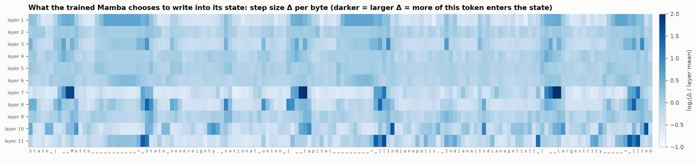

The heatmap shows Δ (how strongly each byte is written into the state, relative to the layer's mean) on a test-set
snippet of Wikipedia infobox markup. Averaged over 64 KB of test text:

| character type | layer 1 | layer 7 | layer 8 | layer 11 |
|---|---|---|---|---|
| word start | 1.22× | 1.16× | **1.76×** | 1.03× |
| inside a word | 0.91× | 0.85× | **0.75×** | 0.84× |
| newline | 1.11× | **2.05×** | **2.01×** | **2.60×** |
| markup characters | 1.10× | **1.59×** | 1.12× | **1.43×** |

The same mechanism is visible on the synthetic task. Even before the selective-copying Mamba has learned to output the
answer, its first layer already writes **data tokens 2.3× more strongly than noise tokens** (Δ 0.152 vs. 0.065). The
LTI ablation, by construction, cannot tell them apart:

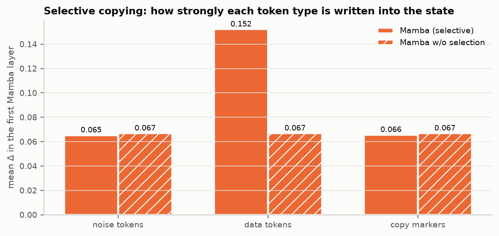

---

## 6. Engineering notes (problems hit on real hardware)

- **The naive scan is bandwidth-bound, not compute-bound.** The first full Mamba LM trained at 2.7k tokens/s, against
  45k for the Transformer. Profiling showed the PyTorch scans moving roughly 20 GB of `(B, L, D, N)` intermediates per
  training step. Recomputation plus channel tiling fixed the memory; only the fused kernel fixed the speed (§5.1, 3.8k → 42.8k tokens/s).
- **Windows "sysmem fallback".** On Windows the NVIDIA driver does not raise out-of-memory: it silently pages GPU
  allocations into system RAM, and a job slowed from 0.2 s to 11 s per step. [`runtime.py`](runtime.py) caps PyTorch's
  allocator at the free VRAM so OOM becomes a clean exception. The benchmarks record that exception as the memory wall.
- **A Triton compiler crash.** A 3-D `tl.associative_scan` (time × channel × state) crashed the Triton 3.3 compiler
  on Windows with an access violation. Flattening `(channel, state)` into one axis compiles and is tested. That
  block-parallel variant was *not* faster than the sequential-in-registers kernel on this GPU because of register
  pressure, so it is kept as a tested alternative rather than the default.
- **Batch-1 parallelism.** With batch 1, 16-channel tiles gave only 32 programs for 16 SMs. Channel tiles now shrink
  until there are at least ~128 programs, and the backward pass accumulates dB/dC with atomics instead of a large
  partial-sum buffer. Together these made the long-sequence fwd+bwd about 1.45× faster in GPU time.
- **A PyTorch bug.** In torch 2.5.1 (CPU), `scaled_dot_product_attention` returns NaN for non-contiguous float64
  inputs. The equivalence test caught it, and the reference path now calls `.contiguous()` first.
- **Launch overhead dominates small-model decoding.** One decode step of a 4.7M-parameter model is hundreds of tiny
  kernels, so eager latency is mostly CPU launch overhead. The generation benchmark therefore also replays each step
  from a captured **CUDA graph**, which exposes the true GPU cost.

---

## 7. Limitations

- **Small scale.** The models have about 4.7M parameters and see 32.8M training bytes (about a third of an enwik8
  epoch). They are far from converged, and published enwik8 results use models 10–100× larger. The comparison is fair
  *at this budget*. The Mamba paper reports that the ranking shifts in Mamba's favor at 100M+ parameters.
- **No per-architecture tuning.** Every model uses the same optimizer, learning rate (1.5e-3), schedule and batch. The
  Mamba paper tunes learning rates per architecture, so a tuned Mamba would likely do better.
- **One seed per quality number.** Training runs are single-seed, so differences of a few hundredths of a bpc are within
  the noise one would expect from seed variation. Speed benchmarks report the median of repeated runs, with the
  interquartile range stored in the JSON.
- **Kernel quality.** The Triton kernel walks the sequence step by step inside each program. Mamba's production CUDA
  kernel also fuses the input projections and uses a chunked parallel scan in shared memory. At the training length
  (512) this project's Mamba is therefore still slower to train than the Transformer, even though it scales better.
- **Attention baseline.** The main Transformer uses hand-written attention that materializes the T×T score matrix, as
  the project requires. Fused kernels such as FlashAttention remove the O(T²) memory, but not the O(T²) compute. The
  PyTorch fused-attention line in §5.2 shows how far that moves the memory wall (4K → 128K forward).
- **Synthetic tasks are short.** Each synthetic run trains for 3,000 steps; the Mamba paper trains selective copying for
  400K. A model that "fails" here may only be learning more slowly, not lack the capacity.
- **Evaluation protocol.** Test bpc uses non-overlapping windows with no state carried across them, so early bytes in
  each window have little context. That is fair across models but gives higher numbers than sliding-window evaluation.
- **Not attempted.** Long Range Arena (the ListOps / Path-X data alone is gigabytes); S4's diagonal-plus-low-rank A. Mamba
  (S6) deliberately uses a diagonal A, which is what makes the scan cheap. The dense-matrix ZOH exists only as a test
  reference.

**Next steps.** Scale to 50–100M parameters on a larger GPU. Add a chunked parallel scan in shared memory to the kernel
and fuse the projections into it. Tune learning rates per architecture. Run 3 seeds per configuration. Add LRA ListOps
and longer synthetic training.

---

## 8. Reproduce

```bash
python -m venv .venv && .venv/Scripts/activate        # Linux/macOS: source .venv/bin/activate
pip install torch==2.7.1 --index-url https://download.pytorch.org/whl/cu126
pip install -r requirements.txt
python reproduce.py            # tests → train → eval → benchmarks → synthetic tasks → Δ analysis → plots
python reproduce.py --quick    # smoke-test the whole pipeline in a few minutes
python reproduce.py --only bench,plots
```

Every number in this README comes from a JSON file under [`results/`](results), and every figure is produced by
[`analysis/make_plots.py`](analysis/make_plots.py) from those files. enwik8 is downloaded from its official source
(`mattmahoney.net/dc/enwik8.zip`) and split 90M/5M/5M; the loader fails loudly instead of substituting data.

---

## 9. Repository layout

```
models/
  scan.py           discretization (ZOH/Euler/bilinear), 4 scan algorithms, SelectiveScanFn (custom backward)
  mamba.py          Mamba block (selective or LTI), recurrent step
  transformer.py    manual attention, RoPE, KV cache
  retention.py      RetNet-style retention: parallel / recurrent / chunkwise
  lm.py             layer-pattern language model, parameter-matched presets, generation
  common.py         RMSNorm, MLP, rotary embedding
kernels/
  triton_scan.py    fused selective-scan forward + backward kernels
data/enwik8.py      download, 90/5/5 split, random-window and sequential batches
training/train_lm.py
tasks/              synthetic tasks (MQAR, selective copying) and their training driver
benchmarks/         scan algorithms, model speed/memory vs length, generation latency
analysis/           evaluation, Δ analysis, plotting
tests/              136 correctness tests
results/            all raw results (JSON / JSONL)
plots/              all figures
reproduce.py        one command for everything
```

---

## 10. References

- Gu & Dao (2023). *Mamba: Linear-Time Sequence Modeling with Selective State Spaces.*
- Gu, Goel & Ré (2022). *Efficiently Modeling Long Sequences with Structured State Spaces (S4)*; Gu et al. (2022), *On the
  Parameterization and Initialization of Diagonal State Space Models (S4D).*
- Vaswani et al. (2017). *Attention Is All You Need*; Su et al. (2021). *RoFormer: rotary position embedding.*
- Sun et al. (2023). *Retentive Network: A Successor to Transformer for Large Language Models.*
- Arora et al. (2023). *Zoology: Measuring and Improving Recall in Efficient Language Models* (MQAR).
- Blelloch (1990). *Prefix Sums and Their Applications*; Hillis & Steele (1986). *Data Parallel Algorithms.*
- Lieber et al. (2024). *Jamba: A Hybrid Transformer-Mamba Language Model.*
- Mahoney. *Large Text Compression Benchmark* (enwik8).
