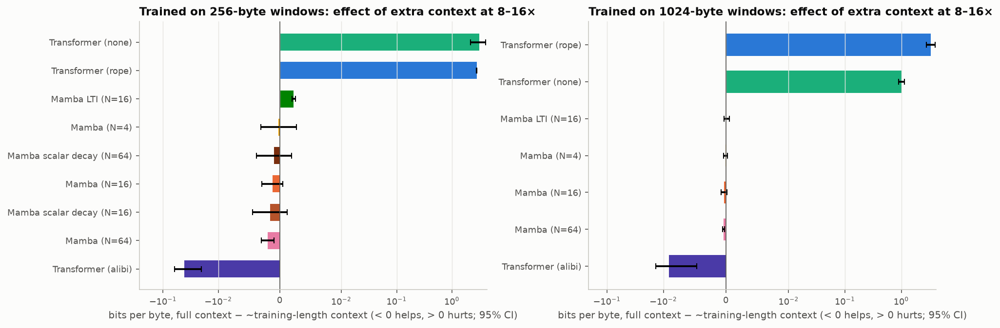

# Abstract

Selective state-space models (SSMs) such as Mamba can process inputs of any length, but whether they behave well beyond the length they were trained on is contested: some studies report a receptive field limited by the training length, others a collapse of the loss. We study the question in a small, fully controlled regime: byte-level language models with about one million parameters, trained on 24.6M bytes of enwik8 at training lengths of 256 and 1,024 bytes. We compare six Mamba-style variants (state sizes 4, 16 and 64; per-state or shared decay; selective or time-invariant) against Transformers with RoPE, NoPE and ALiBi position handling, with three seeds per configuration (48 runs). We measure length generalization as a *context effect*: the change in loss on the same bytes when the model sees its full preceding context rather than about one training length of it. Evaluated on 16,384-byte windows (up to 32 times the training length for models trained on 256 bytes, and up to 16 times for 1,024 bytes), every Mamba variant is stable, but none measurably benefits from the extra context: all seed means lie within 0.004 bits per byte of zero. RoPE and NoPE Transformers degrade by up to 3.4 bits per byte, and only ALiBi shows a clear gain (−0.041 ± 0.021 bits per byte at 8–16 times a training length of 256 bytes). The learned decay rates are consistent with this: the median memory horizon is 2–38 bytes and does not grow when the training length is quadrupled, although a small fraction of modes is much slower. In an exploratory passkey experiment, models trained with the retrieval marker at a fixed position in every window learned to predict the marker from position alone and failed by 5–41 bits per byte beyond the training length; a randomized marker roughly halved this failure but did not remove it. With a position-free protocol, in which half of the windows contain no passkey and the marker's position is independent of the window boundary, the failure disappeared in all three seeds, and the models no longer predicted the marker from position. No Mamba model learned the retrieval task itself in any protocol, even at gaps far inside the training length, while ALiBi did; these experiments therefore do not establish whether small selective SSMs can learn long-range recall. Our results separate stability from context use, and show that position-dependent regularities in training data can produce failures that look like architectural length-generalization limits.

# Introduction {#sec:intro}

Linear-time recurrent sequence models compress the past into a fixed-size state. Selective state-space models [@gu2023mamba; @dao2024ssd] make the state update depend on the input, which lets them decide what to keep, and they now match Transformers on many language-modeling benchmarks at moderate scale [@waleffe2024empirical]. Because the state has a fixed size, such models can in principle read arbitrarily long inputs. Whether they *generalize* to inputs longer than those seen in training is a different question, and the evidence is mixed. @benkish2025decimamba report that Mamba's effective receptive field is restricted by the training length. @chen2025stuffed report that Mamba-2 models fail beyond the training length because they never learn to forget when the state is large relative to the training length. @lu2025modulation attribute the failure to the spectrum of the state-transition matrix, and @buitrago2025unexplored to states that are never visited during training. Most of this evidence comes from pretrained models with 100M or more parameters, where training length, data and tuning cannot be varied freely.

This report studies the question at a scale small enough to control every variable on one 4 GB laptop GPU, and asks what can be concluded there. Two findings emerge. First, the small Mamba models we train are *stable but short-sighted*: their loss beyond the training length neither rises nor falls measurably, because the decay rates they learn forget most information within tens of bytes. Second, a passkey experiment that was meant to force long-range memory instead revealed how easily a training format with a position-dependent regularity produces a failure that looks like an architectural length-generalization limit: both Mamba and attention models learned to predict a marker from its position, and failed by tens of bits per byte beyond the training length. A corrected, position-free version of the same task removed the failure. We report the passkey experiments as exploratory: the first two protocols use one seed each, and Mamba never learned the retrieval itself.

# Related work {#sec:related}

**Selective state-space models.** S4 [@gu2022s4] and its diagonal variants [@gu2022s4d] model sequences with a linear time-invariant (LTI) state-space recurrence. Mamba [@gu2023mamba] makes the step size $\Delta$ and the input and output projections $B$ and $C$ functions of the input, which allows content-dependent forgetting; Mamba-2 [@dao2024ssd] restricts the decay to one scalar per head. MambaByte [@wang2024mambabyte] applies Mamba to bytes. @waleffe2024empirical compare Mamba, Mamba-2 and hybrids with Transformers at 8B parameters.

**Length generalization of SSMs.** @benkish2025decimamba measure an effective receptive field through Mamba's implicit attention and find that it is set by the training length; their DeciMamba removes low-importance tokens using $\Delta$. @chen2025stuffed (Stuffed Mamba) find that Mamba-2 models from 36M to 1.3B parameters retain too much information when the state is large relative to the training length, and fit scaling laws for the training length needed to learn forgetting. LongMamba [@ye2025longmamba] and MambaExtend [@azizi2025mambaextend] extend the context of trained models without retraining, by filtering the tokens that enter slowly decaying channels and by rescaling discretization step sizes, respectively; @lu2025modulation argue that the spectrum of $A$, not $\Delta$ alone, governs state growth. @buitrago2025unexplored propose that recurrent models fail on states not reached during training, and fix this with state passing; they also note that a model attending only to the last training length would generalize trivially, which is the regime we observe. @rathjens2026probing find, in an image-reconstruction task, that Mamba adapts its strategy to the training-length distribution and could not reproduce the state-size effect of Stuffed Mamba. Our setting differs from all of these in scale (about 1M parameters), data (raw bytes) and in training every configuration from scratch with three seeds.

**Position and length generalization in Transformers.** Rotary position embeddings [@su2021roformer] extrapolate poorly beyond the training length, which motivated ALiBi, a linear distance penalty designed for extrapolation [@press2022alibi]. Transformers without position encodings (NoPE) still learn positional information through the causal mask [@haviv2022nope], and on synthetic reasoning tasks they can length-generalize better than models with explicit position encodings [@kazemnejad2023impact].

**Measuring context use.** Comparing the loss on the same target tokens under different amounts of context is an established method [@khandelwal2018sharp; @sun2021longrange]; @buitrago2025unexplored define a related “effective remembrance”. Evaluating long windows conflates context use with the number of tokens that have little context, an issue discussed by @press2021shortformer. We adopt the same-tokens approach and show how much the alternatives can mislead in our setting.

**Recall and passkey retrieval.** Associative recall separates attention from efficient recurrent models [@arora2024zoology], and Transformers learn copying more easily than SSMs [@jelassi2024repeat]. Passkey retrieval was introduced as a long-context test by @mohtashami2023landmark. That recurrent networks can learn to count is long known [@weiss2018practical].

# Research questions and contributions {#sec:rq}

We ask three questions about small byte-level models:

1. **RQ1.** Beyond its training length, does a selective SSM's loss degrade, stay flat or improve, and how does this depend on state size, decay parameterization, selectivity and training length?
2. **RQ2.** What do the learned decay rates and state norms say about the answer to RQ1?
3. **RQ3.** Does the picture change when training contains a task that can only be solved by remembering information over a long gap?

Contributions:

- A controlled multi-seed comparison (48 runs) of six Mamba-style variants and three Transformer position-handling schemes at two training lengths, measured with a same-bytes context effect. All Mamba variants are stable and none measurably benefits from the extra context (@sec:results).
- Measurements of learned memory horizons and state norms, which show that most information is forgotten within tens of bytes and that the horizon distribution does not track the training length (@sec:mech).
- Evidence that a passkey format with a position-dependent regularity teaches both Mamba and attention models to predict the marker from position, and that this alone produces a large loss beyond the training length; and a position-free protocol under which the failure disappears (@sec:passkey).
- A complete release: code written from first principles with 161 tests, configurations, raw results, and an audit log of claims that earlier versions of this project made and later withdrew.

We do not claim novelty for the evaluation method (@sec:related) or for the general observation that recurrent models can count.

# Models and methodology {#sec:method}

## Selective state-space layer {#sec:ssm}

Each Mamba block maps its input to $x_t \in \mathbb{R}^{D}$ (after a projection, a causal depthwise convolution of width 4 and a SiLU nonlinearity) and runs, for every channel $d$ and state index $n$, the recurrence

$$
\begin{aligned}
h_t[d,n] &= \exp(\Delta_t[d]\,A[d,n])\, h_{t-1}[d,n] + \frac{\exp(\Delta_t[d]\,A[d,n]) - 1}{A[d,n]}\, B_t[n]\, x_t[d], \\
y_t[d] &= \textstyle\sum_{n=1}^{N} C_t[n]\, h_t[d,n] + E[d]\, x_t[d],
\end{aligned}
$$ {#eq:ssm}

which is the exact zero-order-hold discretization of a diagonal continuous-time system; $E$ is a learned per-channel skip connection (called $D$ in the Mamba paper; we use $D$ for the number of channels). The step size is $\Delta_t = \operatorname{softplus}(W_\Delta\, u_t + b_\Delta)$, where $u_t$ is a rank-8 projection of $x_t$, and $B_t$, $C_t$ are linear functions of $x_t$. The decay is $A[d,n] = -\exp(a[d,n])$ with learned $a$. We use two parameterizations: *S4D decay*, one value per channel and state index, initialized to $A[d,n] = -(n+1)$ [@gu2022s4d]; and *scalar decay*, one value per channel shared by all state indices, initialized uniformly in $[-16,-1]$, analogous to Mamba-2. In the *non-selective* (LTI) ablation, $\Delta$, $B$ and $C$ are learned constants. The output $y_t$ is gated by $\operatorname{SiLU}(z_t)$ of a second projection, as in Mamba.

## Same-bytes context effect {#sec:ce}

Let $\ell_t(c)$ be the model's loss in nats on the byte at position $t$ of a window, given the $c$ bytes that precede it. For a training length $L$, let $S_{ab}$ be the set of positions in the band $[aL, bL)$, pooled over all evaluation windows of $W$ bytes. Then

$$
\mathrm{CE}(a,b) = \frac{1}{\ln 2}\cdot\frac{1}{|S_{ab}|}\sum_{t \in S_{ab}} \left[\ell_t(t) - \ell_t(c_t)\right],
$$ {#eq:ce}

where $\ell_t(t)$ uses the full context from the start of the window (all $t$ preceding bytes) and $\ell_t(c_t)$ uses between $L/2$ and $L$ bytes of context, obtained from overlapping windows of length $L$ with stride $L/2$ (keeping the second half of each). CE is in bits per byte; it is negative when the extra context helps and positive when it hurts. Both terms score identical bytes, so the measure is not affected by which text sits at which position, nor by the number of bytes that have little context. We use $W = 16{,}384$ and 16 windows (262,144 validation bytes), and report bands 1–2, 2–4, 4–8, 8–16 and 16–32 times $L$.

Two simpler measures are misleading here. The bits per byte of non-overlapping windows of length $L' > L$ falls with $L'$ even for a model that uses no extra context, because a longer window has proportionally fewer bytes near its start. Comparing the loss at different positions inside one long window compares different text, so it mixes the effect of context with the difficulty of whatever text happens to sit at each position. Earlier versions of this project reported both kinds of numbers; they were withdrawn (see `docs/AUDIT.md`).

## Memory horizon and state norm {#sec:horizon}

From @eq:ssm, the contribution of $x_s$ to $h_t[d,n]$ is scaled by $\prod_{u=s+1}^{t}\exp(\Delta_u[d] A[d,n]) = \exp\!\big(A[d,n]\sum_{u=s+1}^{t}\Delta_u[d]\big)$. Replacing the sum by $(t-s)\bar{\Delta}[d]$, where $\bar{\Delta}[d]$ is the mean step size of channel $d$ on held-out text, gives the memory horizon of mode $(d,n)$,

$$
\tau[d,n] = \frac{1}{|A[d,n]|\;\bar{\Delta}[d]} \quad \text{bytes},
$$ {#eq:horizon}

the average e-folding time of that mode's memory. We estimate $\bar{\Delta}$ on the first 16,384 validation bytes. The horizon bounds how long a mode *can* retain information on typical text; it does not show that the information is used, it ignores how $B_t$ writes into and $C_t$ reads from the state, and individual tokens with unusually small $\Delta_t$ can be retained longer. We also record the root-mean-square (RMS) of the SSM state after 1K, 2K, 4K, 8K and 16K bytes of one validation sequence, computed by chunked processing with exact state passing.

# Data and experimental protocol {#sec:protocol}

**Data.** enwik8 [@hutter2006prize], the first $10^8$ bytes of an English Wikipedia XML dump, with the standard split of 90M training, 5M validation and 5M test bytes [@alrfou2018char]. The vocabulary is the 256 byte values and the metric is bits per byte (bpc). All analyses use the validation split; the test split was not used for any decision and serves only for the confirmation in @sec:test.

**Models.** All models have model width 128, RMSNorm pre-normalization, residual connections and tied input and output embeddings. Mamba models have 8 Mamba blocks (expansion 2, so $D = 256$). Transformers have 5 blocks of 4-head causal attention and a feed-forward layer of width 512, with RoPE, no position encoding (NoPE) or ALiBi. The configurations have 0.83–1.23M non-embedding parameters (@tab:main); they are not exactly parameter-matched, and the state size changes the parameter count.

**Training.** AdamW [@loshchilov2017adamw] with $\beta = (0.9, 0.95)$, weight decay 0.1, gradient clipping at 1.0, 150 warmup steps and cosine decay to $10^{-4}$, bf16 autocast, 3,000 steps of 8,192 bytes (24.6M bytes; batch 32 at $L = 256$, batch 8 at $L = 1024$). Peak learning rates were chosen by a sweep over $\{1,2,4,8,16,32\} \times 10^{-3}$ at $L = 512$ for 1,500 steps (@sec:lr): $1.6\times10^{-2}$ for Mamba and $8\times10^{-3}$ for Transformers. Only S4D-decay Mamba with $N = 16$ and the RoPE Transformer were swept; the other variants reuse their family's rate.

**Main study.** Nine configurations at $L = 256$ and seven at $L = 1024$ (scalar decay only at 256), seeds 0, 1 and 2: 48 runs. We report means with 95% confidence intervals from the $t$ distribution with 2 degrees of freedom. With three seeds these intervals are wide, and we treat differences smaller than about 0.01 bits per byte, whether in bpc or in context effect, as unresolved, even when the interval excludes zero.

**Hardware.** One NVIDIA RTX 3050 Laptop GPU (4 GB, of which PyTorch was capped at 2.97 GiB), PyTorch 2.7.1 with CUDA 12.6, Windows 11. The fused GPU scan kernel uses atomic additions in its backward pass, so runs are not bitwise reproducible; a deterministic mode exists and was verified to be bitwise reproducible, but was not used for these runs.

# Results {#sec:results}

Table: Main results (validation split; mean ± 95% confidence interval over three seeds). bpc: bits per byte at the training length $L$. CE: same-bytes context effect (@eq:ce) in bits per byte for positions 1–2, 2–4, 4–8, 8–16 and 16–32 times $L$; negative values mean the extra context helps. For $L = 1024$ the 16–32× band does not fit in the 16,384-byte evaluation window. {#tab:main}
!include generated/table_main.md

**Quality at the training length.** At $L = 256$, the five selective Mamba variants reach 1.836–1.847 bpc and cannot be told apart with three seeds. The non-selective ablation is worse (1.874 ± 0.001), as are all Transformers (ALiBi 1.906, RoPE 1.930, NoPE 2.325). The NoPE Transformer trains poorly at $L = 1024$ (3.14 bpc), so its length-generalization numbers at that length describe an undertrained model.

**Beyond the training length (RQ1).** Every Mamba configuration, at both training lengths, has a context effect whose seed mean lies within 0.004 bits per byte of zero in every evaluated band: up to 32 times $L$ for $L = 256$ and up to 16 times $L$ for $L = 1024$ (16,384 bytes in both cases). The most consistent deviation is a gain of about 0.003 bits per byte in the 1–2× band at $L = 256$, where the full context has 256–512 bytes instead of 128–256; it is below our resolution of 0.01 bits per byte and we do not interpret it. Neither state size (4 to 64), decay parameterization nor selectivity changes this picture: the selective models do not collapse even when the state is large relative to the training length ($N = 64$ at $L = 256$), and they do not exploit long context either. RoPE and NoPE Transformers degrade sharply, by 2.8 and 3.1 bits per byte at 8–16 times $L$ when trained at $L = 256$, as expected for rotary embeddings without extension [@press2022alibi]; that NoPE also fails here, unlike on the synthetic tasks of @kazemnejad2023impact, shows that its behavior depends on the setting. ALiBi is the only model with a clear gain from extra context: −0.041 ± 0.021 bits per byte at 8–16× for $L = 256$. For $L = 1024$ its effect, −0.009 ± 0.004, has the same sign in every seed but is below our resolution, so we do not count it as an established improvement (@fig:ce).

{#fig:ce}

**Test split.** Re-measuring every run on the held-out test split, which was used for nothing else, gives the same picture (@tab:test): the context-effect seed means of all selective Mamba configurations are within 0.004 bits per byte of zero in every band, and the non-selective one within 0.007. RoPE and NoPE again degrade (+3.2 and +3.3 bits per byte at 8–16× for $L = 256$), and ALiBi again improves at $L = 256$ (−0.047 ± 0.023), with the same small, unresolved effect at $L = 1024$ (−0.009 ± 0.002). Test-split bpc is 0.02–0.06 lower than validation bpc for every model, a property of the split rather than of any model.

# Mechanistic analysis {#sec:mech}

Table: Learned memory horizons (@eq:horizon, in bytes) and state norms of the Mamba models of @tab:main (mean ± 95% CI over three seeds). Per model, horizons are pooled over channels and state indices, summarized per layer, and the median over layers is reported. “Longest mode” gives the range over seeds of the slowest mode in any layer. State RMS: largest per-layer ratio of the SSM state RMS at 16K bytes to that at 1K bytes. {#tab:mech}
!include generated/table_mechanism.md

**Horizons are short and do not follow the training length (RQ2).** For S4D decay, the median horizon over channels decreases from 40–76 bytes for the slowest state index to 1–24 bytes for the fastest (@fig:mech a), and the median over all modes is 2–38 bytes (@tab:mech). Increasing $N$ adds faster modes, so the median horizon falls from 37.9 bytes ($N = 4$) to 2.5 bytes ($N = 64$) at $L = 256$. Quadrupling the training length leaves the distribution essentially unchanged in bytes: for $N = 16$ the slowest-index median is 52.5 bytes at $L = 256$ and 56.3 at $L = 1024$, and the 99th percentile 806 and 685 bytes. Scalar decay gives a median of 9–10 bytes for every state index. The non-selective ablation retains information longest (slowest-index median 105–137 bytes), yet gains no more from extra context.

**A minority of modes is slow.** The horizon distribution has a long tail: 0.1–19% of modes have horizons longer than the training length, and the slowest mode in each model lasts $3\times10^{3}$ to $8\times10^{6}$ bytes. These modes did not translate into a measurable benefit from context beyond $L$. Horizons alone therefore cannot explain the absence of context use; they show only that most of the state is overwritten quickly, and that whatever the slow modes carry does not improve next-byte prediction at this scale.

**State norms stay bounded.** After plain-text training, the largest per-layer state RMS at 16K bytes is 1.2–1.8 times its value at 1K bytes (seed means; @tab:mech, @fig:mech b). We see no sign of the growth associated with state collapse in larger models [@chen2025stuffed; @lu2025modulation]. This is consistent with @rathjens2026probing, who also did not find a state-size effect, but our models are much smaller than those of @chen2025stuffed, so we do not consider it a failure to reproduce their result.

{#fig:mech}

## Exploratory: passkey training and a learned position clock {#sec:passkey}

To test whether forcing long memory changes the picture (RQ3), we inserted a passkey into training windows of $L = 512$ bytes: a STORE marker (byte 1) followed by 8 random lowercase letters, ordinary text, then a RECALL marker (byte 2) followed by the same letters. Bytes 1 and 2 never occur in enwik8. The recalled letters can only be predicted from memory, and the loss on them is part of the ordinary training loss. Evaluation uses held-out sequences of 64 bytes of text, the STORE block, a gap of $g$ bytes of text and the RECALL block, and counts a key as recalled if all 8 letters are the model's top prediction under teacher forcing (chance is $26^{-8}$; per letter, 1/26 or 4.70 bits).

We ran three protocols (@tab:passkey). They are exploratory: 5b and 5c use one seed each.

- **Fixed end (5b).** Every window contained one passkey, with the RECALL block ending the window, so the RECALL marker always appeared at position 503. The gap was uniform in 128–494 bytes. Five Mamba variants, RoPE and ALiBi; 6,000 steps (49.2M bytes).
- **Random end (5c).** As 5b, but the RECALL block was placed at a random position. Every window still contained exactly one RECALL, so the probability of meeting it at the next position, given that it has not yet appeared, still rises to 1 at the end of the window. Mamba ($N = 16$, S4D decay; $N = 64$, scalar decay).
- **Position-free (5d).** Each window contains a passkey with probability 0.5; the STORE block starts at a uniformly random position and the RECALL marker follows after a gap uniform in 16–448 bytes, truncated at the window end as if the window were cut from a continuous stream. The probability of meeting a RECALL marker at a given position, given that none has appeared yet, then never exceeds 0.0013 per byte. Mamba ($N = 16$) and ALiBi, three seeds each, 10,000 steps (81.9M bytes), with no early stopping.

Table: Passkey experiments at $L = 512$; the number of seeds is in parentheses. Keys exact: percentage of 8-letter keys recalled exactly at the given gap (– where that gap was not evaluated). bpc at $L$ and context effect (CE, bits per byte) are measured on plain held-out text without markers. P(RECALL): the model's probability that the next byte is the RECALL marker, on plain text; the first position where it exceeds 0.5 (“never” if it does not) and its mean beyond position 512. State RMS as in @tab:mech. {#tab:passkey}
!include generated/table_passkey.md

**Recall.** Under the fixed-end protocol, only ALiBi learned the task: 100% of keys at gap 256, 99% at 512 and 14% at 1,024. All five Mamba variants and RoPE stayed at chance at every gap. Under the position-free protocol, ALiBi again learned the task within the training length (98–100% of keys at gaps 64 to 512 in all three seeds), recalled 33–58% at twice the training length, and none from a gap of 2,048 bytes on, where its letter accuracy fell to 2–9%, close to chance; and Mamba again stayed at chance in all three seeds, at every gap from 64 to 16,384 bytes; its recall accuracy during training also remained at chance (about 4% of key letters) for all 10,000 steps. Mamba's failure is therefore a failure to learn the task at all within our budget, not a failure to extrapolate it, and it says nothing about recall beyond the training length.

**A position clock.** The fixed-end models, scored on plain text without any marker, failed beyond the training length by 4.9 to 41.5 bits per byte at 8–16× (@tab:passkey). The cause is visible directly: on plain text, every fixed-end Mamba model assigns probability above 0.5 to the RECALL marker from position 406–508 onward, and a mean probability of 0.73–1.00 beyond position 512 (@fig:passkey a). A byte predicted to be the marker with near certainty costs about 30 bits, which accounts for the failure. Two controls rule out simpler explanations: adding the STORE block that every training window contained did not change the loss (29.3 vs. 29.4 bits per byte at positions 512–1,024 for $N = 16$), and the scalar-decay models already predicted the marker before position 512, which explains why their validation bpc at the training length was poor (3.72 and 2.26). The same clock appears in ALiBi attention (onset at position 485, mean probability 0.84 beyond 512), which accounts for ALiBi's +6.3 bits per byte here, against −0.041 and −0.009 after plain-text training at $L = 256$ and $1024$; attention without position encoding is known to learn absolute position from the causal mask [@haviv2022nope]. The RoPE model crosses 0.5 only briefly. Randomizing the RECALL position (5c) moved the onset to positions 569–753 and roughly halved the failure (+15.2 and +17.9 bits per byte at 8–16×), but did not remove it. Under the position-free protocol the clock is gone: no Mamba or ALiBi model assigned probability above 0.5 to the marker at any position, the probability stayed near 0.0005 at every position before and after the training length, which matches the frequency of RECALL markers in the training windows (about 0.28 per 512 bytes), and the context effect of Mamba was within 0.003 bits per byte of zero in every band in all three seeds, as after plain-text training. ALiBi again benefited from extra context (−0.020 to −0.026 bits per byte in every band). That ALiBi uses distant context for prediction but cannot retrieve a key beyond about twice its training length is consistent with its linear distance penalty, which down-weights distant positions regardless of their content. The position-free protocol differs from the fixed-end one in where and how often the passkey occurs, and also in a longer budget (10,000 vs. 6,000 steps) and a wider gap range; it is unlikely, though not excluded, that these secondary differences rather than the removal of the positional cue account for the change. Together with the direct observation of the clock in the fixed-end models, this is strong evidence that the failures of the first two protocols were caused by the position-dependent training format.

These failures are not caused by state overflow: the 5c model with $N = 16$ failed by 15 bits per byte while its state RMS grew only 2.3-fold, within the range of plain-text training. Fixed-end Mamba models also show state-norm growth of 9–16 times, but this is a symptom of the counter rather than its cause.

{#fig:passkey}

# Discussion {#sec:discussion}

**Stability is not context use.** A recurrent model whose state forgets within tens of bytes is stable beyond its training length almost by construction: from its point of view, position 10,000 looks like position 300. This is the regime of all our plain-trained Mamba models, and it is what @buitrago2025unexplored describe as trivial length generalization. Stability measured by perplexity curves should therefore be reported together with a measure of context use, such as the same-bytes context effect, before it is read as evidence of long-context ability. Conversely, models that do use extra context (ALiBi here) may be the ones that need a position scheme designed for extrapolation.

**What the horizons can and cannot establish.** The horizon (@eq:horizon) is a mean-field summary of the decay dynamics. It shows that most of each model's state is overwritten within a few dozen bytes, and that this does not change with the training length. It cannot show that a slow mode carries useful information, and it does not model input-dependent bursts of small $\Delta_t$. Every model has slow modes; they did not produce a measurable context benefit. We therefore read the horizons as consistent with, not as a proof of, the absence of context use.

**Why position-dependent regularities mislead.** Any regularity tied to the position inside a training window, such as an event at a fixed position, or one that is guaranteed to occur exactly once per window, can be learned by counting. Both Mamba and causal attention learned such a counter here, from a single marker byte. Beyond the training length the counter takes values never seen in training, and the model's predictions fail in a way that resembles the state-collapse failures reported for large models. When the same task was made position-free, the failure disappeared, with the same architecture, data and evaluation. We do not claim that this explains the failures of pretrained models. It suggests, however, that before a length-generalization failure is attributed to architecture, one should rule out that the training format (fixed-length packing, document boundaries, end-of-sequence tokens, synthetic tasks placed at bounded positions) leaks position. The position-free protocol of @sec:passkey is one way to construct synthetic training tasks that do not.

**Alternative explanations.** (i) The absence of a context benefit for Mamba could reflect the data rather than the architecture: byte-level Wikipedia markup may contain little information beyond a few hundred bytes that a model of this size can exploit. ALiBi's gain (0.04 bits per byte at $L = 256$) shows that some usable information exists beyond the training length, but also that it is small at this scale; the Mamba models may not have learned to use it within 24.6M bytes. (ii) The failure of Mamba to learn recall may be a matter of optimization budget or learning rate rather than capacity: an earlier check in this project found that pure Mamba reached 52.9% on a 4-pair associative-recall task after 9,000 steps but under 8% after 3,000. (iii) The learning rate was tuned for one Mamba and one Transformer configuration and transferred to the others.

# Limitations and threats to validity {#sec:limits}

- **Scale.** About 1M parameters and 24.6M training bytes are orders of magnitude below the models in the work we compare with. The conclusions are about this regime; they may not transfer to large pretrained models.
- **Data and modality.** One dataset (enwik8), bytes rather than subword tokens, two training lengths.
- **Seeds and statistics.** Three seeds per configuration in the main study; one seed for passkey protocols 5b and 5c. Confidence intervals with 2 degrees of freedom are wide. No correction for multiple comparisons.
- **Tuning.** Learning rates were swept for two configurations at $L = 512$ and transferred. The NoPE Transformer is undertrained at $L = 1024$.
- **Parameter matching.** Configurations differ by up to 48% in non-embedding parameters (0.83M–1.23M).
- **Measurement.** The context effect uses 16 windows of the validation split and bf16 inference; differences below about 0.001 bits per byte are within numerical noise. The horizon is a stationary approximation.
- **Passkey.** Mamba never learned the recall task in any protocol, not even within the training length, so RQ3 remains open. Protocols 5b and 5c use one seed. Only Mamba with $N = 16$ and ALiBi were trained with the position-free protocol. ALiBi recall beyond a gap of 1,024 was not measured under the fixed-end protocol (out of memory under the 2.97 GiB cap).
- **Reproducibility.** Runs are not bitwise reproducible because of atomic additions in the GPU kernel. One GPU and one software stack were used.

# Conclusion {#sec:conclusion}

In a controlled small-scale setting, selective state-space models trained on bytes are stable far beyond their training length but show no measurable benefit from the extra context, and their learned decay rates forget most information within tens of bytes regardless of the training length. Transformers with RoPE or no position encoding fail beyond the training length, and only ALiBi shows a clear gain from extra context, at the shorter training length. A passkey experiment showed that a training format whose events are tied to the window boundary teaches both recurrent and attention models to count positions, and that this alone produces large failures beyond the training length; a position-free version of the task removed the failure. Whether small selective SSMs can learn to retrieve information over long gaps, and how that changes their length generalization, remains open; answering it requires a training regime in which they first learn the task within the training length, under a protocol that does not leak position.

# Acknowledgements and disclosure of AI assistance {#sec:ack}

This work was done without external funding on personal hardware. Large language model assistants (Anthropic's Claude) were used extensively for implementation, running experiments, analysis scripts, literature search and drafting of this text. The authors designed the study, reviewed all code, results and text, and are responsible for every claim; the AI tools are not authors. All numbers in tables and figures are generated from the released result files by the released scripts.

# Appendix

## Hyperparameters and parameter counts {#sec:hparams}

Table: Training and model settings shared by all runs of the main study. {#tab:hparams}
| Setting | Value |
|---|---|
| Data | enwik8, bytes; train 90M / validation 5M / test 5M |
| Model width | 128; RMSNorm; tied embeddings; vocabulary 256 |
| Mamba block | expansion 2 ($D = 256$), convolution width 4, $\Delta$ rank 8, state size $N \in \{4, 16, 64\}$, ZOH discretization; 8 blocks |
| Transformer block | 4 heads of width 32, feed-forward width 512; 5 blocks |
| Optimizer | AdamW, $\beta = (0.9, 0.95)$, weight decay 0.1, gradient clipping 1.0 |
| Schedule | 150 warmup steps, cosine to $10^{-4}$; 3,000 steps of 8,192 bytes |
| Peak learning rate | Mamba $1.6\times10^{-2}$; Transformer $8\times10^{-3}$ |
| Precision | bf16 autocast, fp32 master weights; scan state in fp32 |
| Evaluation | validation split; bpc on the first 1M bytes; context effect on 16 windows of 16,384 bytes |

## Learning-rate sweep {#sec:lr}

Table: Validation bpc after 1,500 steps of 16 × 512 bytes for each peak learning rate (seed 0). The best rate per model is in bold. {#tab:lr}
!include generated/table_lr.md

## Test-split confirmation {#sec:test}

Table: The main study re-measured on the enwik8 test split (mean ± 95% CI over three seeds). The test-split context effect uses 8 windows of 16,384 bytes (131,072 bytes); the validation column (16 windows) repeats @tab:main. {#tab:test}
!include generated/table_test.md

## Passkey protocol details {#sec:passkey-details}

The fixed-end and random-end protocols insert one passkey into every training window with a gap uniform in $[L/4, L - 18] = [128, 494]$ bytes. The position-free protocol (`data/passkey.py`, `insert_passkey_stream`) inserts a passkey with probability 0.5; the STORE block starts uniformly in $[0, L - 9]$, the gap is uniform in $[16, 448]$, and RECALL bytes that fall outside the window are dropped (on average 2.2 recalled bytes per window). Recall is evaluated at gaps 64, 128, 256 and 512 (inside the training length) and 1,024 to 16,384 (beyond), with 256 sequences per gap up to $4L$ and 128 beyond. The plain-text controls in `analysis/passkey_text_control.py` use 16 held-out sequences (2 for Transformers, because of memory) and gap 8,192 (4,096 for Transformers).

## Reproducibility {#sec:repro}

Configurations: `configs/stage3_lr_sweep.json`, `stage4_pilot.json`, `stage4b_scalar_decay.json`, `stage5a_seeds.json`, `stage5b_passkey.json`, `stage5c_passkey_random.json`, `stage5d_passkey_stream_mamba.json` and `stage5d_passkey_stream_alibi.json`, each run with `python -m experiments.run <config>`, which also runs the analysis for every run. The follow-up evaluations that needed the whole GPU (ALiBi under the position-free protocol, the stored P(RECALL) curves of the earlier protocols, and the test-split check) are in `experiments/post_stage5d.sh`. Tables and figures: `python -m analysis.aggregate_seeds`, `python -m analysis.paper_tables`, `python -m analysis.paper_figures`; the paper: `python docs/paper/build.py`. Every run directory records its configuration, the git commit, the software versions and the GPU state. The stage-5d runs record commit `84f2971` with uncommitted changes; these were the edits to `data/passkey.py` and `training/train_lm.py` that add the position-free protocol, made before the runs started and committed unchanged in `26d3233`; no model or kernel code changed. What has been verified: from a fresh clone of the repository, the 161 tests (including GPU and Triton kernel tests) pass, and the released scripts regenerate every table and figure of this paper, the aggregate files and the CSV export byte-for-byte from the released result files. What has not been verified: retraining the models from scratch from a clean clone (roughly 15 GPU-hours of training and several hours of evaluation on the hardware above), and re-running the per-model analyses, which need the trained checkpoints; these are not in the repository because of their size. The clean-clone check used the same Python environment as the experiments rather than a fresh installation from `requirements-lock.txt`. Pinned dependencies are in `requirements-lock.txt`. An audit of earlier claims and their corrections is in `docs/AUDIT.md`.
